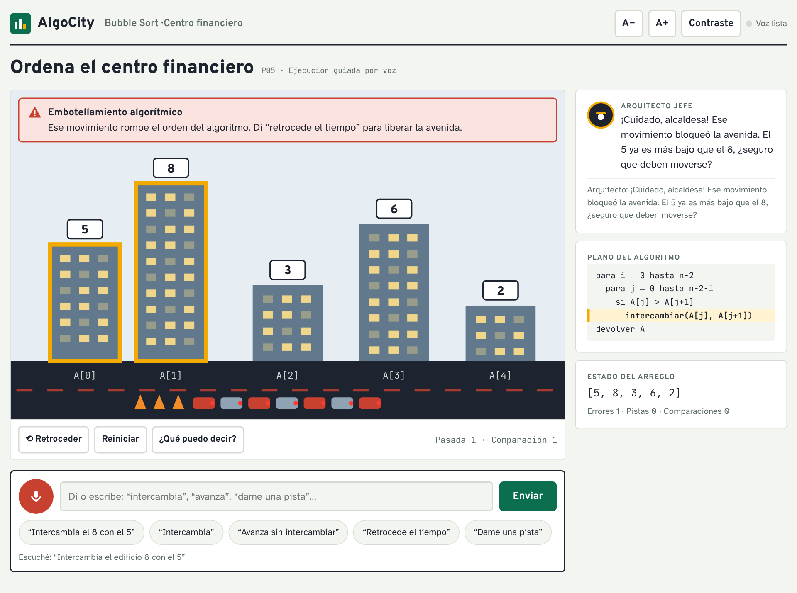
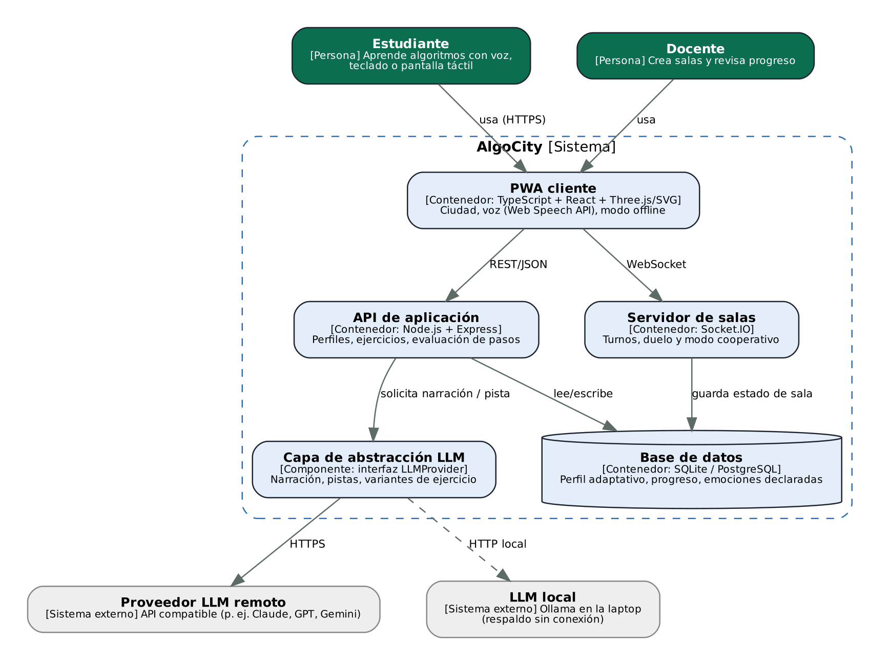

# AlgoCity: algoritmos como ciudad navegable

Aplicación web progresiva (PWA) en la que los algoritmos se convierten en una ciudad que el estudiante recorre y modifica con la voz. Un arreglo es una fila de rascacielos, un árbol binario de búsqueda es un sistema de avenidas y un grafo es una red de metro. El asistente **Arquitecto Jefe** (un LLM) narra cada paso, detecta errores lógicos y da pistas graduales.

Proyecto del curso **CC451-A Interacción Humano-Computador**, Universidad Nacional de Ingeniería, 2026-II.



## Estado actual (PC02)

- Análisis de usuarios, PACT, 22 RF, 13 RNF, 23 historias de usuario y matriz de trazabilidad: [`docs/informe-PC02.pdf`](docs/informe-PC02.pdf)
- Prototipo navegable de fidelidad media (10 pantallas) con simulación funcional de Bubble Sort: [`prototipo/index.html`](prototipo/index.html)
- Arquitectura C4: [`docs/arquitectura-c4.md`](docs/arquitectura-c4.md)
- Datos simulados: [`data/mock/`](data/mock)
- Interfaz de la capa de abstracción del LLM: [`src/llm/LLMProvider.ts`](src/llm/LLMProvider.ts)

## Requisitos comunes del curso

| Requisito | Cómo se cumple |
|---|---|
| Interfaces de voz | Comandos de voz en español (Web Speech API) y narración TTS, con equivalentes por botón, teclado y texto |
| LLM con capa de abstracción | Interfaz `LLMProvider` con proveedor remoto, local (Ollama) y textos predefinidos de respaldo |
| PWA | Manifest + service worker, modo sin conexión para ejercicios descargados |
| Personalización continua | Perfil con preferencias, ritmo, errores por tipo y emociones declaradas o inferidas |
| Multiusuario | Salas cooperativas y de duelo con turnos por voz (Socket.IO) |
| Diseño emocional (Norman) | Visceral: ciudad iluminada y celebraciones · Conductual: respuesta inmediata y "retrocede el tiempo" · Reflexivo: resumen, insignias e identidad de urbanista |
| Licencia | MIT ([`LICENSE`](LICENSE)) |

## Guía de instalación

### Ver el prototipo (sin instalar nada)

1. Clona el repositorio:
   ```bash
   git clone <URL-del-repositorio> algocity
   cd algocity
   ```
2. Abre `prototipo/index.html` en Chrome o Edge (doble clic), o sírvelo localmente:
   ```bash
   npx serve .
   # luego abre http://localhost:3000/prototipo/
   ```
3. Usa la barra superior **Prototipo · fidelidad media** para saltar entre pantallas, o sigue el flujo desde P01.

> El micrófono funciona en Chrome/Edge si el navegador lo permite. Si no, usa los atajos de voz o escribe el comando: ambos ejecutan la misma lógica.

### Flujo sugerido para la simulación

1. P01 → "Empezar como invitado" → P02 → "Guardar y entrar a mi ciudad".
2. P03 → "Continuar Bubble Sort".
3. Atajo **"Intercambia el 8 con el 5"** → aparece el embotellamiento.
4. **"Retrocede el tiempo"** → la avenida se libera. **"Dame una pista"**.
5. Usa "Intercambia" o "Avanza" en cada pareja hasta ordenar `[2, 3, 5, 6, 8]`.
6. "Ver el resumen de hoy" → P07 → "Compartir en una sala" → P08 → P09.

### Desarrollo (fase F4, en curso)

```bash
npm install
cp .env.example .env     # LLM_PROVIDER=remote|local|canned, LLM_API_KEY=...
npm run dev              # PWA en http://localhost:5173 y API en :3001
```

Requisitos: Node.js 20+, navegador Chromium reciente; opcional Ollama para el LLM local.

## Datos simulados

| Archivo | Contenido |
|---|---|
| `data/mock/usuarios.json` | 6 usuarios con distintos perfiles (novato, avanzado, baja visión, dificultad del habla, TDAH, docente) |
| `data/mock/ejercicios.json` | Ejercicios de los 6 algoritmos con su metáfora urbana |
| `data/mock/salas.json` | Salas cooperativas, de duelo y de clase |
| `data/mock/sesiones.json` | Sesiones con pasos, errores, pistas y emociones para probar el perfil adaptativo |

## Arquitectura



Stack previsto: TypeScript + React + SVG/Three.js (PWA), Node.js + Express (API), Socket.IO (salas), SQLite/PostgreSQL, capa `LLMProvider`.

## Integrantes

| Integrante | Código |
|---|---|
| Pineda Garcia, Diego Ronaldo | 20222117F |
| Sanchez Vega, Andre Alvaro | 20220043E |
| Trujillo Serva, Luis Andre | 20220428D |

Profesor: Núñez Iturri, Ciro Javier.
