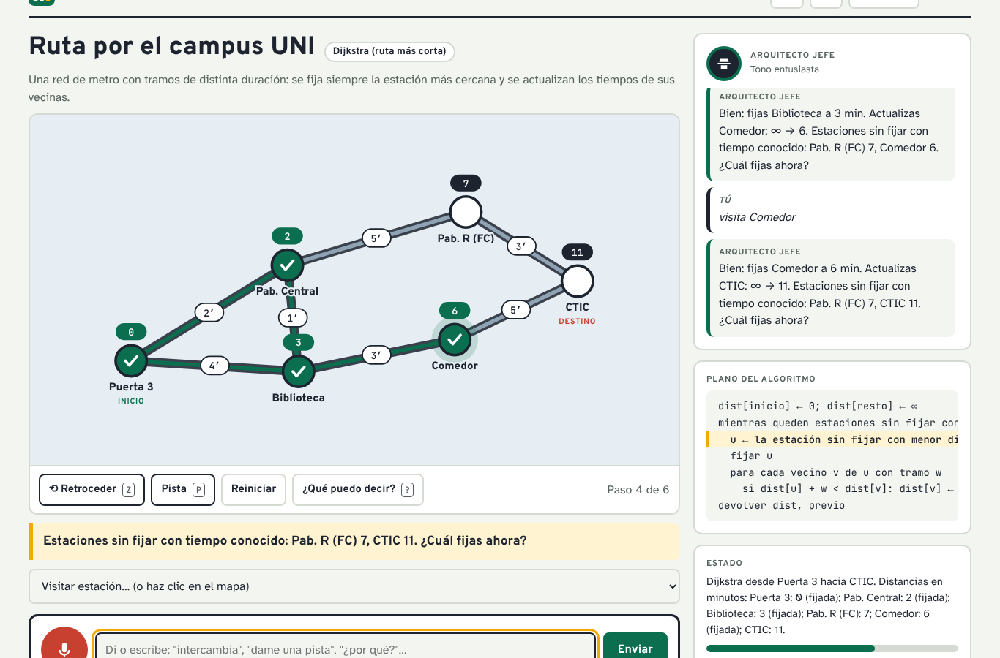

# AlgoCity: algoritmos como ciudad navegable

**AlgoCity** es una aplicación web progresiva (PWA) para **aprender y practicar algoritmos con la voz**. Cada algoritmo es una ciudad: un arreglo es una avenida de edificios, un árbol binario de búsqueda es un sistema de avenidas y un grafo es una red de metro. El estudiante ejecuta cada paso diciendo “intercambia”, “izquierda” o “visita la Biblioteca”; un motor determinista valida el paso, la ciudad reacciona al instante y el asistente **Arquitecto Jefe** (un LLM) explica cada error, da pistas graduales y genera ejercicios nuevos enfocados en lo que el estudiante falla.

Proyecto del curso **CC451-A Interacción Humano-Computador**, Universidad Nacional de Ingeniería, 2026-II.



## ¿Para qué sirve?

| Para | Qué hace |
|---|---|
| **Estudiantes de cursos de algoritmos** | Practicar los 6 algoritmos clásicos paso a paso, con explicación de cada error, pistas en 3 niveles y **modo examen** con nota vigesimal antes de una práctica calificada. |
| **Su propia tarea** | Ingresar **sus propios datos** (el arreglo o el grafo de su práctica) y resolverlos en la ciudad. |
| **Aprendizaje adaptativo** | El perfil recuerda en qué tipo de paso se equivoca y la IA genera **variantes enfocadas en esos errores**. |
| **Docentes** | Crear una **sala de clase**, compartir el código y ver en vivo el progreso, quién necesita ayuda y los errores más frecuentes del grupo. |
| **Accesibilidad** | Todo se puede hacer por voz, teclado, botones o texto; narración por voz, alto contraste, texto ampliable, modo calma. |

## Estado actual (PC03)

Prototipo funcional: **11 pantallas** y **los 6 algoritmos** funcionando de punta a punta, con voz, LLM con respaldo, perfil adaptativo, salas en tiempo real y PWA instalable. El detalle por historia de usuario, con enlaces al código y capturas, está en **[`docs/avance-PC03.md`](docs/avance-PC03.md)**.

| Requisito del curso | Cómo se cumple | Código |
|---|---|---|
| Interfaces de voz | Reconocimiento con la Web Speech API (gratis, sin API key) y respaldo con Whisper en el servidor; narración con `speechSynthesis`. Confirmación cuando la confianza es menor a 0,7. | [`web/src/voice/voice.ts`](web/src/voice/voice.ts), [`shared/commands.ts`](shared/commands.ts) |
| LLM con capa de abstracción | `LLMProvider` con cadena remoto (cualquier API compatible con OpenAI: OpenAI, Groq, Gemini…) → local (Ollama) → textos predefinidos. Cambio de proveedor solo por `.env`; conmuta si tarda más de 3 s. | [`shared/llm/LLMProvider.ts`](shared/llm/LLMProvider.ts), [`server/llm.ts`](server/llm.ts) |
| PWA | Manifest, service worker (Workbox) e instalación; todos los ejercicios funcionan sin conexión. | [`vite.config.ts`](vite.config.ts) |
| Personalización continua | Perfil persistente con preferencias, ritmo, errores por tipo, dominio por algoritmo y emociones **declaradas** e **inferidas** (2 errores seguidos, pausas largas, rachas). Recomienda el siguiente reto. | [`shared/profile.ts`](shared/profile.ts) |
| Multiusuario | Salas **cooperativas** (una ciudad compartida, turnos que se piden por voz, estado autoritativo en el servidor), **de duelo** y **de clase** con panel docente. Socket.IO. | [`server/rooms.ts`](server/rooms.ts), [`web/src/screens/Sala.tsx`](web/src/screens/Sala.tsx) |
| Diseño emocional (Norman) | **Visceral:** ciudad que se ilumina, fuegos artificiales, embotellamientos animados. **Conductual:** respuesta inmediata, “retrocede el tiempo”, tono y velocidad de voz según el ánimo, modo calma. **Reflexivo:** resumen con pregunta de reflexión, insignias, “tu ciudad” que crece con cada ejercicio e identidad de urbanista. | [`web/src/city/`](web/src/city), [`web/src/practice/usePractice.ts`](web/src/practice/usePractice.ts) |
| Arquitectura C4 | Contexto, contenedores y componentes. | [`docs/arquitectura-c4.md`](docs/arquitectura-c4.md) |
| Datos simulados | Usuarios, ejercicios, salas y sesiones usados por la app (perfiles de prueba y salas de demostración). | [`data/mock/`](data/mock) |
| Licencia | MIT | [`LICENSE`](LICENSE) |

## Guía de instalación

Requisitos: **Node.js 20 o superior** y un navegador Chromium reciente (Chrome o Edge) para usar el micrófono. Funciona en laptop y en celular.

```bash
git clone https://github.com/pineda-404/AlgoCity.git algocity
cd algocity
npm install
npm run dev
```

Abre **http://localhost:5173**. `npm run dev` levanta la PWA (Vite, puerto 5173) y el servidor de API y salas (Node + Socket.IO, puerto 3001).

Versión de producción (una sola URL, con service worker activo):

```bash
npm run build
npm start          # http://localhost:3001
```

> Para probarlo desde un celular en la misma red, abre `http://IP-DE-TU-LAPTOP:3001`. El micrófono del navegador solo funciona en `https` o en `localhost`; para el celular, despliega en un servicio con HTTPS o usa un túnel (por ejemplo `npx localtunnel --port 3001`).

### Configurar el LLM (opcional)

Sin configurar nada, el Arquitecto Jefe usa textos predefinidos y la app funciona completa. Para usar un modelo real:

```bash
cp .env.example .env
```

| Opción | Variables en `.env` |
|---|---|
| API remota (OpenAI, Groq, Gemini, OpenRouter…) | `LLM_PROVIDER=remote`, `LLM_BASE_URL`, `LLM_API_KEY`, `LLM_MODEL` |
| Modelo local con [Ollama](https://ollama.com) | `LLM_PROVIDER=local`, `OLLAMA_MODEL=llama3.2` (antes: `ollama pull llama3.2`) |
| Sin LLM | `LLM_PROVIDER=canned` |

El indicador de la barra superior muestra “IA conectada” cuando hay un modelo disponible. Si el estudiante no da su consentimiento en Preferencias, su texto nunca se envía al proveedor remoto.

### Voz

- **Chrome, Edge y Safari:** Web Speech API, sin configuración.
- **Firefox u otros navegadores sin Web Speech API:** configura `STT_API_KEY` (Whisper vía OpenAI o Groq) en `.env` y elige “Whisper en el servidor” en Preferencias.
- **Sin micrófono:** todo funciona con texto, botones y atajos de teclado (`I`, `A`, `←`, `→`, `Z`, `P`, `R`, `?`, `M`).

## Cómo probarlo (guion de demostración)

1. En la bienvenida, **“Empezar”** como invitado y ajusta tus preferencias, o usa **“Probar con un perfil simulado”** (por ejemplo, Lucía Quispe, que falla al decidir intercambios).
2. En **Mi ciudad**, indica cómo llegas y pulsa **Empezar** en el reto recomendado.
3. Di o escribe **“intercambia”** cuando no corresponde → aparece el **embotellamiento** con la explicación. Di **“retrocede el tiempo”** y **“dame una pista”** (3 niveles).
4. Pregunta **“¿por qué?”** al Arquitecto Jefe, o di **“estoy frustrado”** para ver cómo cambia el tono y se ofrece el modo calma.
5. Termina el ejercicio → **resumen** con reflexión, ánimo al cerrar e insignias. Prueba **“Variante enfocada en mis errores”**.
6. En **Algoritmos**, usa **“Usar mis datos”** con un arreglo o grafo propio, o activa el **modo examen**.
7. En **Salas**, crea una sala cooperativa y ábrela en otra ventana con otro perfil: turnos con **“pido turno”** / **“paso el turno”**.
8. Entra con el perfil simulado **Carmen Ramírez (docente)** para ver el **panel docente** de la clase `CLS-2026`.

## Pruebas

```bash
npm test            # 56 pruebas: motores, intérprete de comandos, perfil adaptativo y respaldo del LLM
npm run typecheck
npm run build && npm start
npm run capturas    # recorrido de punta a punta en Chrome: resuelve los 6 algoritmos y genera docs/img/pc03
```

`npm run capturas` necesita Chrome instalado (`CHROME_PATH=/ruta/a/chrome` si no está en `/usr/bin/google-chrome`).

## Estructura

```
shared/            Lógica común a la PWA y al servidor
  engines/         Motores deterministas de los 6 algoritmos (validan cada paso)
  llm/             Capa LLMProvider (remoto, local, predefinido) y prompts del Arquitecto Jefe
  commands.ts      Intérprete de comandos de voz y texto
  profile.ts       Perfil adaptativo: ánimo inferido, recomendación, insignias
  exercises.ts     Catálogo, variantes y datos propios del estudiante
server/            Express + Socket.IO: API del LLM, transcripción y salas
web/src/           PWA en React + TypeScript
  city/            Escenas SVG: avenida de edificios, sistema de avenidas, red de metro
  voice/           Proveedores de voz (Web Speech API, Whisper) y narración
  screens/         Pantallas P01–P11
data/mock/         Datos simulados
docs/              Informe PC02, avance PC03, arquitectura C4 y capturas
prototipo/         Prototipo navegable de la PC02 (referencia histórica)
```

## Datos simulados

| Archivo | Contenido | Dónde se usa |
|---|---|---|
| `data/mock/usuarios.json` | 6 perfiles (novato, avanzado, baja visión, dificultad del habla, TDAH, docente) | “Probar con un perfil simulado” y participantes de las salas de demostración |
| `data/mock/ejercicios.json` | 13 ejercicios de los 6 algoritmos, incluidos 2 mapas esquemáticos del campus UNI | Catálogo |
| `data/mock/salas.json` | Salas `URB-4821` (cooperativa), `CLS-2026` (clase) y `DUE-7730` (duelo) | Se crean al iniciar el servidor |
| `data/mock/sesiones.json` | Sesiones con pasos, errores, pistas y emociones | Historial de los perfiles simulados |

## Integrantes

| Integrante | Código |
|---|---|
| Pineda Garcia, Diego Ronaldo | 20222117F |
| Sanchez Vega, Andre Alvaro | 20220043E |
| Trujillo Serva, Luis Andre | 20220428D |

Profesor: Núñez Iturri, Ciro Javier.

## Licencia

[MIT](LICENSE)
