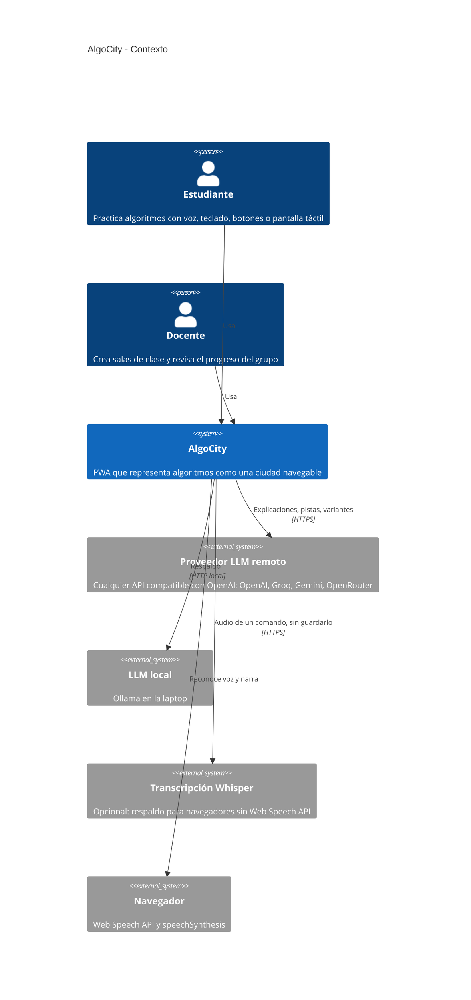
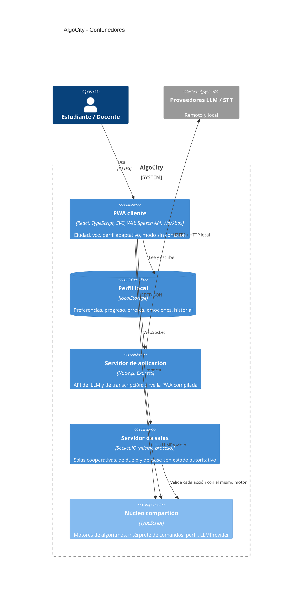
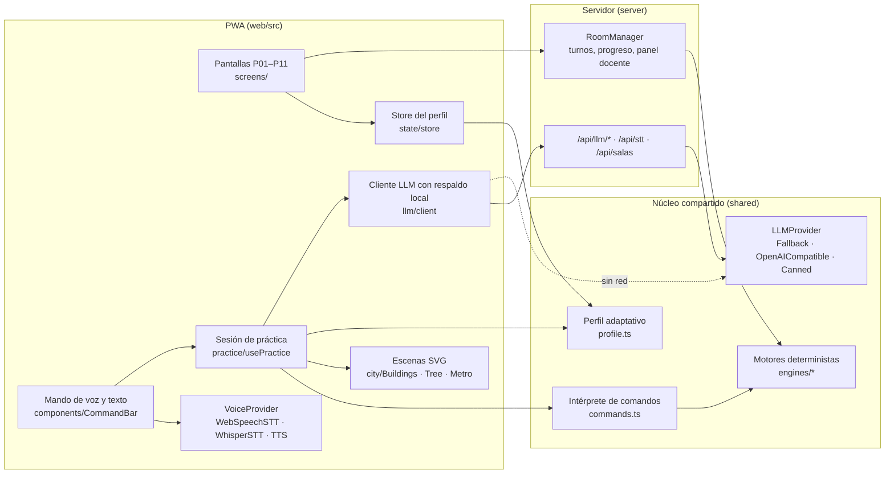
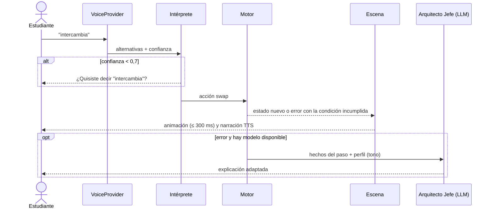

# Arquitectura de AlgoCity (modelo C4)

Versión PC03. Los diagramas usan Mermaid (GitHub los dibuja directamente). El diagrama de la PC02 se conserva en [`img/c4.png`](img/c4.png).

## Nivel 1 · Contexto

## Nivel 2 · Contenedores

## Nivel 3 · Componentes

## Flujo de un comando de voz

## Decisiones

| Decisión | Motivo | Requerimiento |
|---|---|---|
| El motor de cada algoritmo es determinista y valida cada paso; el LLM solo recibe los hechos y los explica | El LLM nunca “inventa” un paso incorrecto y la respuesta es inmediata aunque no haya red | RF-07, RF-08, RNF-03 |
| `LLMProvider` con cadena remoto → local → predefinido y tiempo límite de 3 s | Cambio de proveedor por configuración y continuidad sin red | RF-11, RNF-08 |
| Un cliente “compatible con OpenAI” para remoto y local | Un solo adaptador sirve para OpenAI, Groq, Gemini, OpenRouter y Ollama | RF-11 |
| Web Speech API como reconocimiento principal y Whisper como respaldo | Gratis y sin API key en Chrome/Edge/Safari; Firefox queda cubierto por el servidor | RF-03, RNF-13 |
| Intérprete de comandos local con reglas; el LLM solo para preguntas libres | Los comandos son pocos y cortos: reglas responden al instante y sin costo | RF-03, RNF-03 |
| El núcleo (`shared/`) lo usan la PWA y el servidor | La sala cooperativa valida con el mismo motor que la práctica individual | RF-17, RNF-10 |
| Perfil guardado en el dispositivo (localStorage), con descarga y borrado | Privacidad por defecto; no requiere cuentas para el prototipo | RF-13, RF-20, RNF-07 |
| No se guarda audio; sin consentimiento, el texto no sale a un proveedor remoto | Privacidad (Ley N.° 29733) | RNF-07 |
| Escenas en SVG con lienzo más angosto en celulares | ≥ 30 fps en laptop convencional y legibilidad en móvil | RNF-05, RNF-02 |
| Socket.IO con estado autoritativo en el servidor; 8 personas por sala, 30 salas | Turnos consistentes | RF-17, RNF-09 |

## Pendiente para la entrega final

- Cuentas con servidor y base de datos (SQLite/PostgreSQL) para sincronizar el perfil entre dispositivos; hoy el perfil vive en el dispositivo.
- Reconocimiento Whisper ejecutado dentro del navegador (sin servidor) para Firefox sin conexión.
- Mediciones formales: Lighthouse (RNF-06), tasa de reconocimiento de voz (RNF-04) y SUS con usuarios (RNF-11).
