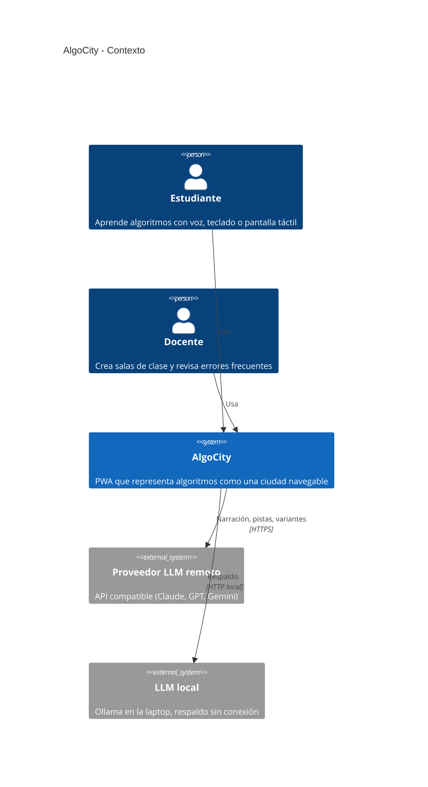
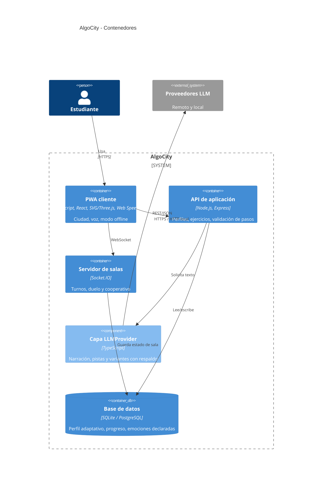

# Arquitectura de AlgoCity (modelo C4)

## Nivel 1 · Contexto

## Nivel 2 · Contenedores

## Decisiones

| Decisión | Motivo | Requerimiento |
|---|---|---|
| El motor de algoritmos es determinista y valida cada paso; el LLM solo narra y da pistas | Evita que el LLM "invente" pasos incorrectos | RF-07, RF-08 |
| `LLMProvider` con cadena de respaldo remoto → local → textos predefinidos | Cambio de proveedor por configuración y continuidad sin red | RF-11, RNF-08 |
| Escenas en SVG por defecto, WebGL opcional | ≥ 30 fps en laptop convencional y celular de gama media | RNF-05 |
| No se almacena audio; solo el texto del comando reconocido | Privacidad (Ley N.° 29733) | RNF-07 |
| Socket.IO con estado autoritativo en el servidor | Turnos consistentes en salas de hasta 8 personas | RF-17, RNF-09 |
